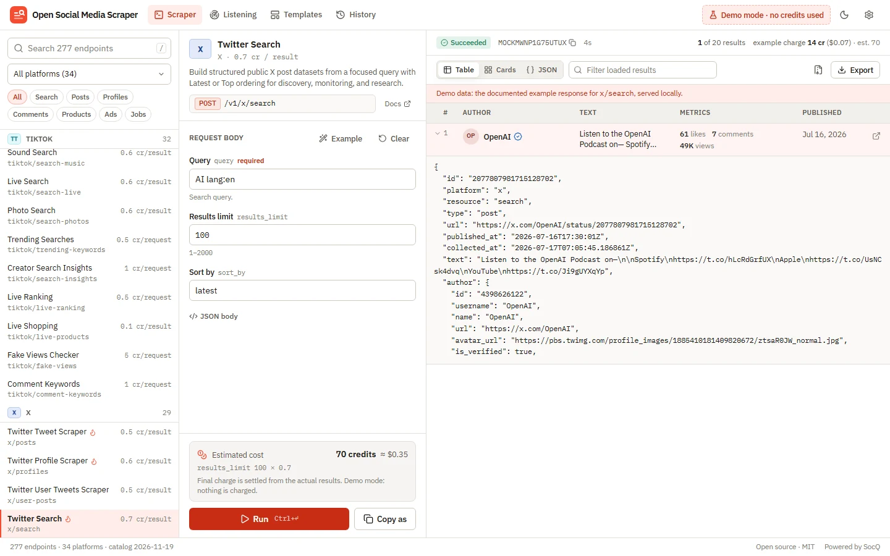
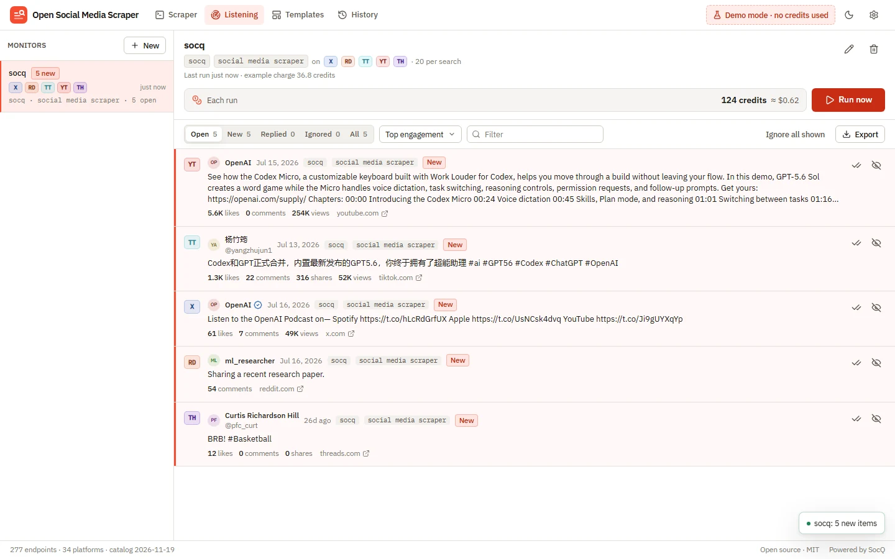
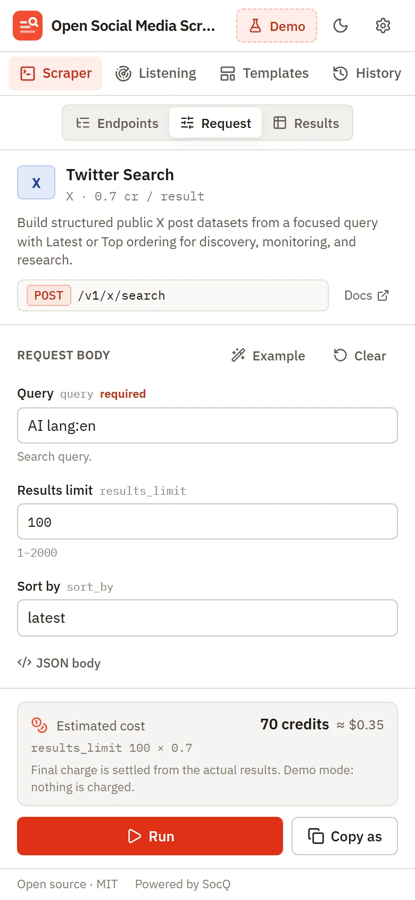
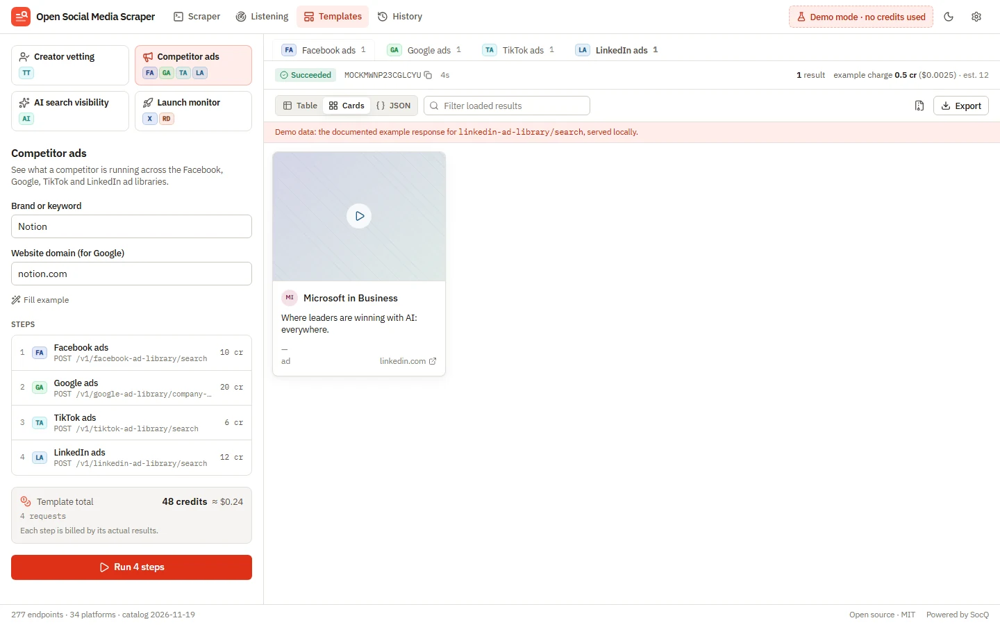
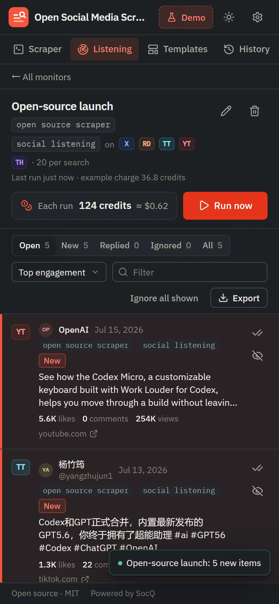
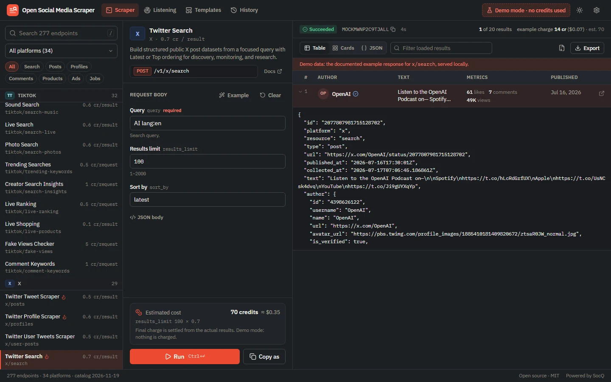

<div align="center">


# Open Social Media Scraper

**Free, open-source social media scraper and social data studio for TikTok, X, Instagram, YouTube, Reddit, LinkedIn and 28 more platforms.**

Social listening and creator research in your browser · no scrapers to maintain · self-host in minutes · MIT

[**Quick start**](#quick-start) · [**Demo mode**](#demo-mode) · [**Features**](#features) · [**Privacy**](#privacy) · [**White-label**](#white-label) · [**Platforms**](#supported-platforms) · [**FAQ**](#faq)

[](LICENSE)




</div>

## How it works

Open Social Media Scraper is a static web app. You bring your own [SocQ](https://socq.ai/?utm_source=open-social-media-scraper&utm_medium=readme)
API key, and the browser calls the SocQ API directly: SocQ collects the public data and returns normalized records
(posts, comments, profiles, ads, products…) that the app shows as a table, as cards or as raw JSON. You never run or
update a scraper yourself, and there is no backend to deploy. Every run is billed to the SocQ account that owns the key;
the app shows the estimated cost before each run and the actual charge after it.

It only collects **public** data, and only what the SocQ endpoints return.

## Features

- **Scraper console for <!-- endpoints-count -->277<!-- /endpoints-count --> endpoints.** Search and filter every endpoint by platform and category
  (search, posts, profiles, comments, products, ads, jobs). The request form is generated from each endpoint's JSON Schema:
  required fields first, lists as one value per line, enums as selects, min/max and step limits, "one of" and
  "not together" rules, plus the documented example values.
- **Cost before you run.** The estimate follows SocQ's billing modes (per request, per result, per input keyword),
  updates as you type, and is shown in credits and dollars. After the run you see the real `credits_amount`.
- **Submit → poll → page.** Tasks are polled with backoff, idempotency keys make retries safe, unfinished tasks resume
  after a reload, and you can load the next page or every page.
- **Results as table, cards or JSON.** Author, text, metrics, published date and link for every normalized schema,
  cards for media items, and a raw JSON view. Filter loaded results; expand any row to see all fields.
- **Export** CSV (flattened, spreadsheet-safe), JSON and JSONL, plus the raw JSONL files SocQ keeps for each task.
- **Copy as code**: cURL, Python, Node.js, or a ready-made prompt for AI agents using the SocQ MCP server.
- **Social listening.** Save keyword monitors across X, Reddit, TikTok, YouTube and Threads search. Run them on demand
  (cost shown first), merge and dedupe by platform + id, highlight what is new since the last run, sort by engagement or
  recency, and mark each item replied or ignored.
- **Research templates.** One-click presets built from normal endpoints: creator vetting (TikTok profile + audience
  demographics), competitor ads (Facebook, Google, TikTok and LinkedIn ad libraries), AI search visibility
  (LLM mentions + Google AI Mode) and a launch monitor (X + Reddit).
- **History** of every run in IndexedDB on your device, with inputs, results and credits.
- **Private by default.** Your key stays in `localStorage`; nothing goes anywhere except the API (see [Privacy](#privacy)).
- **Light and dark themes**, keyboard shortcuts (<kbd>/</kbd> search endpoints, <kbd>Ctrl</kbd>/<kbd>⌘</kbd> + <kbd>Enter</kbd> run),
  and a layout that works down to 390 px wide.

<table>
  <tr>
    <td width="62%"></td>
    <td width="38%"></td>
  </tr>
  <tr>
    <td></td>
    <td></td>
  </tr>
  <tr>
    <td colspan="2"></td>
  </tr>
</table>

<sub>Screenshots use demo mode, which shows the example responses from the SocQ documentation.</sub>

## Quick start

Requires Node.js 20+.

```bash
git clone https://github.com/coolhackboy/open-social-media-scraper.git
cd open-social-media-scraper
npm install
npm run dev
```

Open <http://localhost:5173>, click **Add API key**, paste your key, pick an endpoint and press **Run**.

To build a static site:

```bash
npm run build      # outputs dist/ — host it on any static file server
npm run preview    # preview the production build locally
```

## Demo mode

Add `?mock=1` to the URL (for example <http://localhost:5173/?mock=1>) to try everything without a key. Each endpoint
returns the "Completed Task Response" example from the SocQ documentation, served from a bundled file after a short
simulated queue. Demo mode makes no network requests at all, uses its own IndexedDB databases, and works on any
deployment. An input containing the word "fail" produces a failed task.

## Get an API key

1. Create a key at **[socq.ai/dashboard/api-key](https://socq.ai/dashboard/api-key?utm_source=open-social-media-scraper&utm_medium=readme)**.
2. Paste it under **Settings → SocQ API key**. **Forget key** removes it from the browser.

SocQ is pay as you go. 1 credit = $0.005; prices per endpoint are listed [below](#supported-platforms) and in the app.

## Deploy

The app is a static site: no server, no database. Any static host works (GitHub Pages, Cloudflare Pages, Netlify,
Vercel, S3, Nginx): build command `npm run build`, output directory `dist`. For a sub-path, build with
`npm run build -- --base=/your-path/`. Routes are hash-based, so no rewrite rules are needed.

[`.github/workflows/pages.yml`](.github/workflows/pages.yml) builds and publishes the demo to GitHub Pages on every push
to `main`. Visitors of your deployment bring their own API key; it is never part of the build.

## White-label

Rebrand at build time with environment variables (copy [`.env.example`](.env.example) to `.env.local`, or set them in
your hosting dashboard):

| Variable | Default | Purpose |
| --- | --- | --- |
| `VITE_BRAND_NAME` | `Open Social Media Scraper` | Name in the top bar, page title and Open Graph tags |
| `VITE_BRAND_LOGO_URL` | built-in mark | Square logo (SVG/PNG URL) |
| `VITE_ACCENT` | `hsl(8 92% 58%)` | Accent color; the darker button, text and tint shades are derived |
| `VITE_API_BASE` | `https://api.socq.ai` | API endpoint the browser talks to |
| `VITE_SHOW_POWERED_BY` | `true` | Show the small "Powered by SocQ" footer link |
| `VITE_SITE_URL` | GitHub repo | Your public URL, used for absolute `og:url` / `og:image` |

**Do not put an API key in a `VITE_*` variable.** Everything in the build is visible to every visitor. To offer the
tool to your own users with your own pricing, run a small gateway that implements the same endpoints
(`POST /v1/<platform>/<resource>`, `GET /v1/tasks/{id}`, `GET /v1/tasks/{id}/files`, `GET /v1/account`), authenticates
your users, forwards requests with your SocQ key, and point `VITE_API_BASE` at it.

Design tokens live in [`src/index.css`](src/index.css), UI primitives in [`src/ui/`](src/ui), and all API-specific code
in [`src/lib/api.ts`](src/lib/api.ts) and [`src/config.ts`](src/config.ts).

## Privacy

There is no backend and no analytics. These are **all** the requests the page makes after it has loaded (fonts, icons
and the endpoint catalog are bundled with the app):

| When | Request | Sent |
| --- | --- | --- |
| You press Run (console, listening or template step) | `POST {API base}/v1/<platform>/<resource>` | Your form input as JSON, your key, an `Idempotency-Key` |
| While a task runs, and when you load more results | `GET {API base}/v1/tasks/{task_id}?limit=50[&cursor=…]` | Your key |
| On page load and after each run, if a key is saved | `GET {API base}/v1/account` | Your key |
| You open **Raw files** | `GET {API base}/v1/tasks/{task_id}/files` | Your key |
| You click **Download** on a raw file | the file URL on SocQ's storage | nothing |
| You enable **Load media previews** (off by default) | avatars and thumbnails from the platforms' image servers | nothing (no referrer) |

`{API base}` is `https://api.socq.ai` unless you or the deployer changed it. Links you click (a post, the docs,
socq.ai) open in a new tab. In demo mode the page makes no requests at all.

Your key is stored only in this browser's `localStorage`. Runs, monitors and the listening inbox are stored in IndexedDB
on your device; clearing site data removes them. Exports are generated locally.

## Copy as code

Every request can be copied as cURL, Python, Node.js or an MCP prompt. Snippets read the key from `$SOCQ_API_KEY`, so
they are safe to share:

```python
import os, time, requests

API = "https://api.socq.ai"
HEADERS = {"Authorization": f"Bearer {os.environ['SOCQ_API_KEY']}"}

task = requests.post(f"{API}/v1/reddit/search", headers=HEADERS, json={
    "query": "social listening",
    "results_limit": 25,
}).json()["data"]

while task["status"] not in ("succeeded", "failed"):
    time.sleep(2)
    task = requests.get(f"{API}/v1/tasks/{task['task_id']}", headers=HEADERS).json()["data"]

for item in task["results"]["items"]:
    print(item["author"]["username"], item["metrics"], item["url"])
```

## Supported platforms

<!-- platforms:start -->
<!-- Generated by scripts/readme-platforms.mjs — do not edit by hand. -->

**277 endpoints across 34 platforms** · catalog snapshot 2026-11-19. 1 credit = $0.005.
Prices are SocQ list prices at snapshot time; the app shows an estimate for your exact request and the actual charge afterwards.

| Platform | Endpoints | Examples | Price |
| --- | ---: | --- | --- |
| TikTok | 32 | [Profiles](https://docs.socq.ai/api-manual/tiktok/profiles?utm_source=open-social-media-scraper&utm_medium=readme), [Hashtags](https://docs.socq.ai/api-manual/tiktok/hashtags?utm_source=open-social-media-scraper&utm_medium=readme), [Comments](https://docs.socq.ai/api-manual/tiktok/comments?utm_source=open-social-media-scraper&utm_medium=readme), [Videos](https://docs.socq.ai/api-manual/tiktok/videos?utm_source=open-social-media-scraper&utm_medium=readme), … | from 0.1 cr / result |
| X | 29 | [Twitter Tweet Scraper](https://docs.socq.ai/api-manual/x/posts?utm_source=open-social-media-scraper&utm_medium=readme), [Twitter Profile Scraper](https://docs.socq.ai/api-manual/x/profiles?utm_source=open-social-media-scraper&utm_medium=readme), [Twitter User Tweets Scraper](https://docs.socq.ai/api-manual/x/user-posts?utm_source=open-social-media-scraper&utm_medium=readme), [Twitter Search](https://docs.socq.ai/api-manual/x/search?utm_source=open-social-media-scraper&utm_medium=readme), … | from 0.5 cr / result |
| Instagram | 25 | [Followers Count](https://docs.socq.ai/api-manual/instagram/followers-count?utm_source=open-social-media-scraper&utm_medium=readme), [Posts](https://docs.socq.ai/api-manual/instagram/posts?utm_source=open-social-media-scraper&utm_medium=readme), [Reels](https://docs.socq.ai/api-manual/instagram/reels?utm_source=open-social-media-scraper&utm_medium=readme), [Search](https://docs.socq.ai/api-manual/instagram/search?utm_source=open-social-media-scraper&utm_medium=readme), … | from 0.3 cr / result |
| SEO | 24 | [Google Organic SERP](https://docs.socq.ai/api-manual/seo/google-organic-serp?utm_source=open-social-media-scraper&utm_medium=readme), [Keyword Difficulty](https://docs.socq.ai/api-manual/seo/keyword-difficulty?utm_source=open-social-media-scraper&utm_medium=readme), [Keyword Overview](https://docs.socq.ai/api-manual/seo/keyword-overview?utm_source=open-social-media-scraper&utm_medium=readme), [Keyword Search Volume](https://docs.socq.ai/api-manual/seo/keyword-search-volume?utm_source=open-social-media-scraper&utm_medium=readme), … | from 10 + 0.02 cr / result |
| YouTube | 20 | [Channel Videos](https://docs.socq.ai/api-manual/youtube/channel-videos?utm_source=open-social-media-scraper&utm_medium=readme), [Comments](https://docs.socq.ai/api-manual/youtube/comments?utm_source=open-social-media-scraper&utm_medium=readme), [Transcripts](https://docs.socq.ai/api-manual/youtube/transcripts?utm_source=open-social-media-scraper&utm_medium=readme), [Channels](https://docs.socq.ai/api-manual/youtube/channels?utm_source=open-social-media-scraper&utm_medium=readme), … | from 0.26 cr / result |
| Facebook | 14 | [Pages](https://docs.socq.ai/api-manual/facebook/pages?utm_source=open-social-media-scraper&utm_medium=readme), [Posts](https://docs.socq.ai/api-manual/facebook/posts?utm_source=open-social-media-scraper&utm_medium=readme), [Comments](https://docs.socq.ai/api-manual/facebook/comments?utm_source=open-social-media-scraper&utm_medium=readme), [Video Transcript](https://docs.socq.ai/api-manual/facebook/video-transcript?utm_source=open-social-media-scraper&utm_medium=readme), … | from 0.3 cr / result |
| Reddit | 13 | [Posts](https://docs.socq.ai/api-manual/reddit/posts?utm_source=open-social-media-scraper&utm_medium=readme), [Comments](https://docs.socq.ai/api-manual/reddit/comments?utm_source=open-social-media-scraper&utm_medium=readme), [Subreddit Posts](https://docs.socq.ai/api-manual/reddit/subreddit-posts?utm_source=open-social-media-scraper&utm_medium=readme), [Search](https://docs.socq.ai/api-manual/reddit/search?utm_source=open-social-media-scraper&utm_medium=readme), … | from 0.3 cr / result |
| LinkedIn | 12 | [Profiles](https://docs.socq.ai/api-manual/linkedin/profiles?utm_source=open-social-media-scraper&utm_medium=readme), [Companies](https://docs.socq.ai/api-manual/linkedin/companies?utm_source=open-social-media-scraper&utm_medium=readme), [Posts](https://docs.socq.ai/api-manual/linkedin/posts?utm_source=open-social-media-scraper&utm_medium=readme), [Jobs](https://docs.socq.ai/api-manual/linkedin/jobs?utm_source=open-social-media-scraper&utm_medium=readme), … | from 0.5 cr / result |
| TikTok Shop | 9 | [Search](https://docs.socq.ai/api-manual/tiktok-shop/search?utm_source=open-social-media-scraper&utm_medium=readme), [Products](https://docs.socq.ai/api-manual/tiktok-shop/products?utm_source=open-social-media-scraper&utm_medium=readme), [Product](https://docs.socq.ai/api-manual/tiktok-shop/product?utm_source=open-social-media-scraper&utm_medium=readme), [Product Reviews](https://docs.socq.ai/api-manual/tiktok-shop/product-reviews?utm_source=open-social-media-scraper&utm_medium=readme), … | from 0.3 cr / result |
| Rednote | 8 | [Comment Replies](https://docs.socq.ai/api-manual/rednote/comment-replies?utm_source=open-social-media-scraper&utm_medium=readme), [Home Recommendations](https://docs.socq.ai/api-manual/rednote/home-recommendations?utm_source=open-social-media-scraper&utm_medium=readme), [Note Comments](https://docs.socq.ai/api-manual/rednote/note-comments?utm_source=open-social-media-scraper&utm_medium=readme), [Note Detail](https://docs.socq.ai/api-manual/rednote/note-detail?utm_source=open-social-media-scraper&utm_medium=readme), … | from 1 cr / request |
| Threads | 8 | [Posts](https://docs.socq.ai/api-manual/threads/posts?utm_source=open-social-media-scraper&utm_medium=readme), [Profiles](https://docs.socq.ai/api-manual/threads/profiles?utm_source=open-social-media-scraper&utm_medium=readme), [User Posts](https://docs.socq.ai/api-manual/threads/user-posts?utm_source=open-social-media-scraper&utm_medium=readme), [Post Replies](https://docs.socq.ai/api-manual/threads/post-replies?utm_source=open-social-media-scraper&utm_medium=readme), … | from 0.3 cr / result |
| Douyin | 7 | [Live Room Detail](https://docs.socq.ai/api-manual/douyin/live-room-detail?utm_source=open-social-media-scraper&utm_medium=readme), [User Profile](https://docs.socq.ai/api-manual/douyin/user-profile?utm_source=open-social-media-scraper&utm_medium=readme), [User Videos](https://docs.socq.ai/api-manual/douyin/user-videos?utm_source=open-social-media-scraper&utm_medium=readme), [Video Comments](https://docs.socq.ai/api-manual/douyin/video-comments?utm_source=open-social-media-scraper&utm_medium=readme), … | from 0.1 cr / request |
| Pinterest | 7 | [Pins](https://docs.socq.ai/api-manual/pinterest/pins?utm_source=open-social-media-scraper&utm_medium=readme), [User Pins](https://docs.socq.ai/api-manual/pinterest/user-pins?utm_source=open-social-media-scraper&utm_medium=readme), [Profiles](https://docs.socq.ai/api-manual/pinterest/profiles?utm_source=open-social-media-scraper&utm_medium=readme), [Search](https://docs.socq.ai/api-manual/pinterest/search?utm_source=open-social-media-scraper&utm_medium=readme), … | from 0.5 cr / result |
| Amazon | 6 | [Best Sellers](https://docs.socq.ai/api-manual/amazon/best-sellers?utm_source=open-social-media-scraper&utm_medium=readme), [Product Details](https://docs.socq.ai/api-manual/amazon/product-detail?utm_source=open-social-media-scraper&utm_medium=readme), [Product Search](https://docs.socq.ai/api-manual/amazon/product-search?utm_source=open-social-media-scraper&utm_medium=readme), [Reviews](https://docs.socq.ai/api-manual/amazon/reviews?utm_source=open-social-media-scraper&utm_medium=readme), … | from 0.15 cr / result |
| Telegram | 6 | [Channel Info](https://docs.socq.ai/api-manual/telegram/channel-info?utm_source=open-social-media-scraper&utm_medium=readme), [Channel Scraper](https://docs.socq.ai/api-manual/telegram/channel-posts?utm_source=open-social-media-scraper&utm_medium=readme), [Post Detail](https://docs.socq.ai/api-manual/telegram/post-detail?utm_source=open-social-media-scraper&utm_medium=readme), [Comments](https://docs.socq.ai/api-manual/telegram/post-comments?utm_source=open-social-media-scraper&utm_medium=readme), … | from 0.3 cr / result |
| TikTok Creative Center | 6 | [Top Ads](https://docs.socq.ai/api-manual/tiktok-creative-center/top-ads?utm_source=open-social-media-scraper&utm_medium=readme), [Ad Analysis](https://docs.socq.ai/api-manual/tiktok-creative-center/ad-analysis?utm_source=open-social-media-scraper&utm_medium=readme), [Trending Hashtags](https://docs.socq.ai/api-manual/tiktok-creative-center/trending-hashtags?utm_source=open-social-media-scraper&utm_medium=readme), [Hashtag Insights](https://docs.socq.ai/api-manual/tiktok-creative-center/trending-hashtag-detail?utm_source=open-social-media-scraper&utm_medium=readme), … | from 0.5 cr / result |
| AI Search | 4 | [LLM Mentions](https://docs.socq.ai/api-manual/ai-search/llm-mentions?utm_source=open-social-media-scraper&utm_medium=readme), [Visibility](https://docs.socq.ai/api-manual/ai-search/llm-brand-metrics?utm_source=open-social-media-scraper&utm_medium=readme), [LLM Top Sources](https://docs.socq.ai/api-manual/ai-search/llm-top-mentioned?utm_source=open-social-media-scraper&utm_medium=readme), [Google AI Mode](https://docs.socq.ai/api-manual/ai-search/google-ai-mode?utm_source=open-social-media-scraper&utm_medium=readme) | from 40 + 0.5 cr / result |
| Facebook Ad Library | 4 | [Search](https://docs.socq.ai/api-manual/facebook-ad-library/search?utm_source=open-social-media-scraper&utm_medium=readme), [Company Search](https://docs.socq.ai/api-manual/facebook-ad-library/company-search?utm_source=open-social-media-scraper&utm_medium=readme), [Company Ads](https://docs.socq.ai/api-manual/facebook-ad-library/company-ads?utm_source=open-social-media-scraper&utm_medium=readme), [Ad](https://docs.socq.ai/api-manual/facebook-ad-library/ad?utm_source=open-social-media-scraper&utm_medium=readme) | from 0.5 cr / result |
| Apple App Store | 3 | [App Detail](https://docs.socq.ai/api-manual/apple-app-store/app-detail?utm_source=open-social-media-scraper&utm_medium=readme), [App Reviews](https://docs.socq.ai/api-manual/apple-app-store/app-reviews?utm_source=open-social-media-scraper&utm_medium=readme), [Rankings](https://docs.socq.ai/api-manual/apple-app-store/rankings?utm_source=open-social-media-scraper&utm_medium=readme) | from 0.15 cr / result |
| Bluesky | 3 | [Profile](https://docs.socq.ai/api-manual/bluesky/profile?utm_source=open-social-media-scraper&utm_medium=readme), [Post](https://docs.socq.ai/api-manual/bluesky/post?utm_source=open-social-media-scraper&utm_medium=readme), [User Posts](https://docs.socq.ai/api-manual/bluesky/user-posts?utm_source=open-social-media-scraper&utm_medium=readme) | from 0.19 cr / request |
| Creator | 3 | [Influencer Email Finder](https://docs.socq.ai/api-manual/creator/find-emails?utm_source=open-social-media-scraper&utm_medium=readme), [Social Media Profile Finder](https://docs.socq.ai/api-manual/creator/find-social-profiles?utm_source=open-social-media-scraper&utm_medium=readme), [Age and Gender Detection](https://docs.socq.ai/api-manual/creator/age-gender?utm_source=open-social-media-scraper&utm_medium=readme) | from 1 cr / request |
| Facebook Marketplace | 3 | [Location Search](https://docs.socq.ai/api-manual/facebook-marketplace/location-search?utm_source=open-social-media-scraper&utm_medium=readme), [Search](https://docs.socq.ai/api-manual/facebook-marketplace/search?utm_source=open-social-media-scraper&utm_medium=readme), [Item](https://docs.socq.ai/api-manual/facebook-marketplace/item?utm_source=open-social-media-scraper&utm_medium=readme) | from 0.3 cr / result |
| Google Ad Library | 3 | [Ad](https://docs.socq.ai/api-manual/google-ad-library/ad?utm_source=open-social-media-scraper&utm_medium=readme), [Advertiser Search](https://docs.socq.ai/api-manual/google-ad-library/advertiser-search?utm_source=open-social-media-scraper&utm_medium=readme), [Company Ads](https://docs.socq.ai/api-manual/google-ad-library/company-ads?utm_source=open-social-media-scraper&utm_medium=readme) | from 0.5 cr / result |
| Google Hotels | 3 | [Google Hotels](https://docs.socq.ai/api-manual/google-hotels/search?utm_source=open-social-media-scraper&utm_medium=readme), [Google Hotel Details](https://docs.socq.ai/api-manual/google-hotels/hotel-details?utm_source=open-social-media-scraper&utm_medium=readme), [Hotel Price Tracker](https://docs.socq.ai/api-manual/google-hotels/hotel-prices?utm_source=open-social-media-scraper&utm_medium=readme) | from 0.15 cr / result |
| Google Maps | 3 | [Search](https://docs.socq.ai/api-manual/google-maps/search?utm_source=open-social-media-scraper&utm_medium=readme), [Place Details](https://docs.socq.ai/api-manual/google-maps/place-details?utm_source=open-social-media-scraper&utm_medium=readme), [Reviews](https://docs.socq.ai/api-manual/google-maps/reviews?utm_source=open-social-media-scraper&utm_medium=readme) | from 0.15 cr / result |
| Google Play | 3 | [App Detail](https://docs.socq.ai/api-manual/google-play/app-detail?utm_source=open-social-media-scraper&utm_medium=readme), [App Rankings](https://docs.socq.ai/api-manual/google-play/app-rankings?utm_source=open-social-media-scraper&utm_medium=readme), [App Reviews](https://docs.socq.ai/api-manual/google-play/app-reviews?utm_source=open-social-media-scraper&utm_medium=readme) | from 0.15 cr / result |
| Kwai | 3 | [Profile](https://docs.socq.ai/api-manual/kwai/profile?utm_source=open-social-media-scraper&utm_medium=readme), [User Posts](https://docs.socq.ai/api-manual/kwai/user-posts?utm_source=open-social-media-scraper&utm_medium=readme), [Post](https://docs.socq.ai/api-manual/kwai/post?utm_source=open-social-media-scraper&utm_medium=readme) | from 0.19 cr / request |
| Snapchat | 3 | [Profile](https://docs.socq.ai/api-manual/snapchat/profile?utm_source=open-social-media-scraper&utm_medium=readme), [Spotlight](https://docs.socq.ai/api-manual/snapchat/spotlight?utm_source=open-social-media-scraper&utm_medium=readme), [Spotlight Comments](https://docs.socq.ai/api-manual/snapchat/spotlight-comments?utm_source=open-social-media-scraper&utm_medium=readme) | from 0.19 cr / request |
| Truth Social | 3 | [Post](https://docs.socq.ai/api-manual/truth-social/post?utm_source=open-social-media-scraper&utm_medium=readme), [Profile](https://docs.socq.ai/api-manual/truth-social/profile?utm_source=open-social-media-scraper&utm_medium=readme), [User Posts](https://docs.socq.ai/api-manual/truth-social/user-posts?utm_source=open-social-media-scraper&utm_medium=readme) | from 0.19 cr / request |
| Twitch | 3 | [Profile](https://docs.socq.ai/api-manual/twitch/profile?utm_source=open-social-media-scraper&utm_medium=readme), [User Videos](https://docs.socq.ai/api-manual/twitch/user-videos?utm_source=open-social-media-scraper&utm_medium=readme), [Clip Downloader](https://docs.socq.ai/api-manual/twitch/clip?utm_source=open-social-media-scraper&utm_medium=readme) | from 0.19 cr / request |
| Brand Monitoring | 2 | [Brand Mentions](https://docs.socq.ai/api-manual/brand-monitoring/mentions?utm_source=open-social-media-scraper&utm_medium=readme), [Brand Sentiment Analysis](https://docs.socq.ai/api-manual/brand-monitoring/sentiment?utm_source=open-social-media-scraper&utm_medium=readme) | from 10 + 0.02 cr / result |
| LinkedIn Ad Library | 2 | [Ad](https://docs.socq.ai/api-manual/linkedin-ad-library/ad?utm_source=open-social-media-scraper&utm_medium=readme), [Search](https://docs.socq.ai/api-manual/linkedin-ad-library/search?utm_source=open-social-media-scraper&utm_medium=readme) | from 0.5 cr / result |
| TikTok Ad Library | 2 | [Ad](https://docs.socq.ai/api-manual/tiktok-ad-library/ad?utm_source=open-social-media-scraper&utm_medium=readme), [Search](https://docs.socq.ai/api-manual/tiktok-ad-library/search?utm_source=open-social-media-scraper&utm_medium=readme) | from 0.5 cr / result |
| Link in Bio | 1 | [Link in Bio](https://docs.socq.ai/api-manual/link-in-bio/profile?utm_source=open-social-media-scraper&utm_medium=readme) | from 0.5 cr / result |

<!-- platforms:end -->

## FAQ

<details>
<summary><b>Is it free?</b></summary>

The software is free and MIT-licensed. Collecting data costs SocQ credits on the account that owns the API key, pay as
you go. The app shows the estimate before every run and the actual charge after it.
</details>

<details>
<summary><b>Is this a scraper I have to maintain?</b></summary>

No. The collection runs at SocQ; this app is the interface. When a platform changes, the endpoint keeps returning the
same normalized fields and nothing here needs an update.
</details>

<details>
<summary><b>What data can it collect?</b></summary>

Public data only: public profiles, posts, comments, search results, ad libraries, product listings and similar. Private,
unavailable or empty sources return no records.
</details>

<details>
<summary><b>Does listening run in the background?</b></summary>

No. The app runs only in your browser, so there is no scheduler. Monitors run when you press **Run now**, and every run
shows its cost first. For scheduled jobs, use the "Copy as" snippets in a cron job or CI workflow.
</details>

<details>
<summary><b>Is my API key safe?</b></summary>

The key is stored only in your browser's `localStorage` and sent only to the configured API base over HTTPS. It is
never logged, never included in "Copy as" snippets and never part of a build. Use **Forget key** on shared computers.
</details>

<details>
<summary><b>How do I update the endpoint catalog?</b></summary>

Endpoints, input schemas, docs examples and prices live in [`src/data/catalog.json`](src/data/catalog.json), generated
by [`scripts/build-catalog.mjs`](scripts/build-catalog.mjs) from SocQ's public OpenAPI file and endpoint metadata; demo
responses in `src/data/fixtures.json` come from the documentation examples via
[`scripts/build-fixtures.mjs`](scripts/build-fixtures.mjs). The UI is generated from the schemas, so a new endpoint
needs no new components. See [CONTRIBUTING.md](CONTRIBUTING.md).
</details>

## Tech stack

React 19 · TypeScript (strict) · Vite 6 · Tailwind CSS 4 · Zustand · idb-keyval · Lucide icons · IBM Plex (self-hosted).

```
src/
  ui/          generic primitives (Button, Dialog, Menu, Segmented, Toggle…)
  components/  console (endpoint browser, request form), results, listening, templates, history, settings
  lib/         api client, mock backend, runner (submit/poll/page), schema → form, cost estimates,
               normalization, export, code snippets, listening, templates, storage
  data/        generated endpoint catalog + demo fixtures
  config.ts    brand + backend configuration
scripts/       catalog / fixture generators, catalog checks, tests
```

## Contributing

Issues and PRs are welcome; see [CONTRIBUTING.md](CONTRIBUTING.md). Demo mode (`?mock=1`) lets you work on the UI
without an API key.

## Related

- [SocQ API docs](https://docs.socq.ai/?utm_source=open-social-media-scraper&utm_medium=readme): endpoints, result schemas, MCP and CLI
- [Open Generative Studio](https://github.com/coolhackboy/open-generative-studio): the sister project for AI image and video generation

## License

[MIT](LICENSE) © 2026 PoYo AI · Fonts and icons: see [THIRD_PARTY.md](THIRD_PARTY.md).
